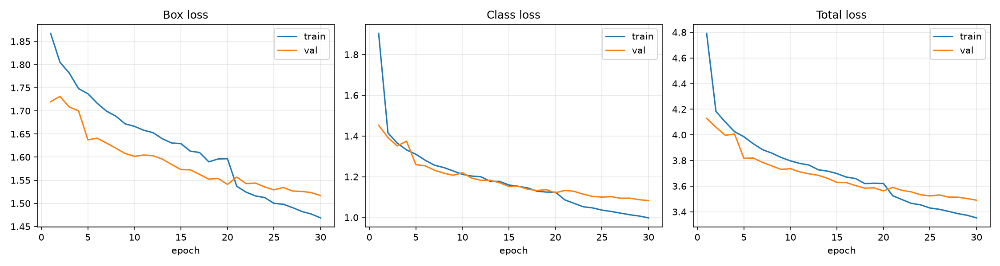
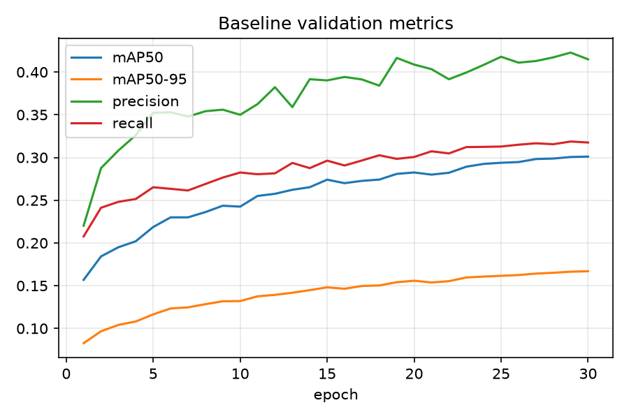
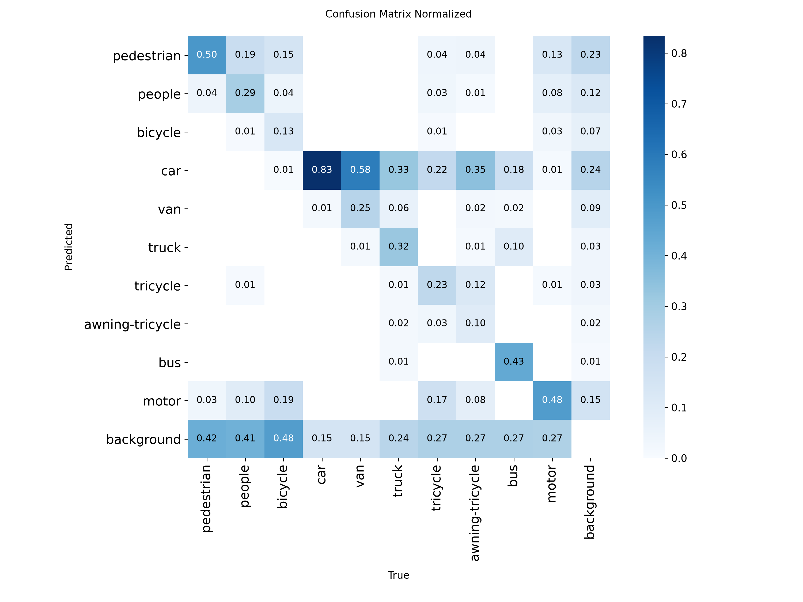
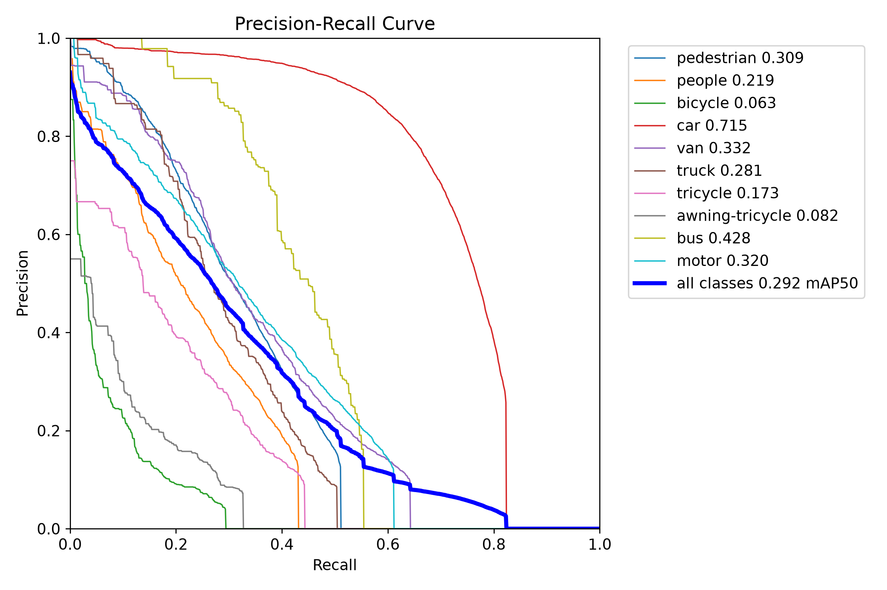
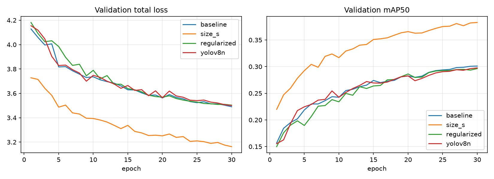

# YOLO11 on VisDrone-DET: training dynamics, controlled experiments and multi-version comparison

CMPE 401 Instructor-defined Project 1. This repo trains a modern YOLO detector on VisDrone-DET (small, dense, real-world drone objects), analyses its loss curves, runs a controlled experiment and a regularisation improvement cycle, and compares YOLO11 against YOLOv8. Every number in the tables is produced by the code in `src/`.

## 1. Objective
Understand the YOLO detection pipeline, fine-tune YOLO11, diagnose over/underfitting from training vs validation loss, and quantify the effect of model size, regularisation and YOLO version.

## 2. Setup
| Item | Value |
|---|---|
| Dataset | VisDrone2019-DET (10 classes, 6,471 train / 548 val images), downloaded automatically by Ultralytics (`VisDrone.yaml`) |
| Framework | Ultralytics (YOLO11 / YOLOv8), PyTorch |
| Training budget | All 6,471 train images (`fraction=1.0`), 30 epochs, batch 16, imgsz 640, seed 0, single NVIDIA GeForce RTX 3060 Laptop GPU (6 GB) |
| Metrics | Precision, Recall, mAP50, mAP50-95 on the full validation set (`best.pt`), inference ms/img |
| Budget choice | 30 epochs per run keeps four full-data runs within a few hours on one laptop GPU (see the Train min column). A typical full study uses 100+ epochs, so absolute mAP would be higher with a longer schedule; all four runs share the same budget, so the comparisons are fair. An earlier pilot (20% of the data, 12 epochs) is kept in `pilot_20pct/` and compared below. |

## 3. How the pipeline works
1. `VisDrone.yaml` downloads the images and converts VisDrone annotations to YOLO format (class, x, y, w, h normalised).
2. YOLO11 = backbone (C3k2 blocks + SPPF + C2PSA attention) -> neck (multi-scale feature fusion, P3/P4/P5) -> decoupled anchor-free head. Small objects are detected on the high-resolution P3 map (stride 8).
3. Loss = box loss (CIoU) + class loss (BCE) + DFL (distribution focal loss for box edges). We report their sum as "total loss".
4. `src/run_experiments.py` trains each configuration; `src/analyze.py` plots curves, builds tables and writes the analysis; `src/build_readme.py` assembles this README.

## 4. Experiments
| Run | Change from baseline (everything else identical) | Purpose |
|---|---|---|
| `baseline` | YOLO11n, imgsz 640 | Part I |
| `size_s` | YOLO11s (more parameters) | Part III: capacity |
| `regularized` | cosine LR, weight decay 0.002 (4x), scale 0.7, mixup 0.1, hsv_s 0.8 | Part IV: overfitting control |
| `yolov8n` | YOLOv8n | Part V: version comparison |

## Results (YOLO11, VisDrone-DET, 100% of train images, 30 epochs, imgsz 640, seed 0)

### Part I - Baseline

| Run | Weights | Params (M) | Precision | Recall | mAP50 | mAP50-95 | Infer ms/img | Train min |
|---|---|---|---|---|---|---|---|---|
| baseline | yolo11n.pt | 2.61 | 0.416 | 0.318 | 0.292 | 0.164 | 2.11 | 30.4 |






### Part II - Loss-curve and fitting analysis

Final-epoch train total loss = 3.352, validation total loss = 3.490 (val/train ratio 1.04). Over the last 5 epochs the validation-loss slope is -0.0093/epoch, training-loss slope -0.0164/epoch, and mAP50 slope +0.0015/epoch. **Diagnosis: close to converged (validation loss flat, no overfitting), though mAP50 is still creeping up.**

*Dataset size.* Training uses 100% of VisDrone-DET (about 6471 images) with many tiny, densely packed objects. This is the whole official training set, so memorising it is harder than with a subset, although 6,471 images of dense small objects is still modest for a deep detector. Here the val/train loss ratio is 1.04, so the model is not memorising the training set at 30 epochs. Validation loss can sit at or below training loss because the training loss is averaged over the epoch while the weights are still improving, and it is measured on augmented images (mosaic, scale, colour jitter) that are harder than the clean validation images. *Model capacity.* YOLO11n has 2.61 M parameters. Validation loss has flattened and the train/validation gap is small, so there is no overfitting at 30 epochs. mAP50 is still rising slightly (about +0.0015 per epoch), so a longer schedule would likely add a little. The size experiment below tests whether capacity is the main bottleneck.

### Part III - Controlled experiment: model capacity (only variable: n -> s)

| Run | Weights | Params (M) | Precision | Recall | mAP50 | mAP50-95 | Infer ms/img | Train min |
|---|---|---|---|---|---|---|---|---|
| baseline | yolo11n.pt | 2.61 | 0.416 | 0.318 | 0.292 | 0.164 | 2.11 | 30.4 |
| size_s | yolo11s.pt | 9.43 | 0.503 | 0.384 | 0.374 | 0.218 | 5.34 | 97.3 |

Changing YOLO11n to YOLO11s (2.61 M -> 9.43 M parameters) changed mAP50 by +0.082 (0.292 -> 0.374) and inference time from 2.11 to 5.34 ms/img. The gain indicates the baseline is capacity-limited on small objects, at the cost of speed.

### Part IV - Improvement cycle: regularisation

**Baseline** (above) -> **Experimental settings** identical except -> **Controlled modification**: `{'cos_lr': True, 'weight_decay': 0.002, 'scale': 0.7, 'mixup': 0.1, 'hsv_s': 0.8, 'fliplr': 0.5}` (cosine LR decay, 4x weight decay, stronger scale/colour augmentation, mixup 0.1). Rationale: the baseline diagnosis in Part II was 'approximately converged (validation loss flat)'. Because the baseline shows no overfitting, this cycle tests the opposite hypothesis: that overfitting control helps even without a visible train/validation gap. It is expected to help little if the model is limited by capacity or training length; capacity is tested separately in Part III.

| Run | Weights | Params (M) | Precision | Recall | mAP50 | mAP50-95 | Infer ms/img | Train min |
|---|---|---|---|---|---|---|---|---|
| baseline | yolo11n.pt | 2.61 | 0.416 | 0.318 | 0.292 | 0.164 | 2.11 | 30.4 |
| regularized | yolo11n.pt | 2.61 | 0.412 | 0.314 | 0.287 | 0.161 | 2.6 | 71.7 |

**Evaluation / analysis**: mAP50 0.292 -> 0.287 (-0.005); val/train loss ratio 1.04 -> 1.02; diagnosis now: approximately converged (validation loss flat). **Conclusion**: regularisation gave no measurable benefit (the -0.005 mAP50 change is within single-seed noise, and the final-epoch validation in the training log shows the same tie), so it is not kept.

### Part V - Multi-version comparison (YOLO11n vs YOLOv8n)

| Run | Weights | Params (M) | Precision | Recall | mAP50 | mAP50-95 | Infer ms/img | Train min |
|---|---|---|---|---|---|---|---|---|
| baseline | yolo11n.pt | 2.61 | 0.416 | 0.318 | 0.292 | 0.164 | 2.11 | 30.4 |
| yolov8n | yolov8n.pt | 3.14 | 0.428 | 0.306 | 0.287 | 0.158 | 3.04 | 67.3 |

YOLOv8n reaches mAP50 0.287 vs 0.292 for YOLO11n (a difference within single-seed noise), with 3.14 M vs 2.61 M parameters. YOLO11n is therefore at least as accurate with about 17% fewer parameters. The inference times (3.04 vs 2.11 ms/img) are indicative only, see the timing note.

### All runs

| Run | Weights | Params (M) | Precision | Recall | mAP50 | mAP50-95 | Infer ms/img | Train min |
|---|---|---|---|---|---|---|---|---|
| baseline | yolo11n.pt | 2.61 | 0.416 | 0.318 | 0.292 | 0.164 | 2.11 | 30.4 |
| size_s | yolo11s.pt | 9.43 | 0.503 | 0.384 | 0.374 | 0.218 | 5.34 | 97.3 |
| regularized | yolo11n.pt | 2.61 | 0.412 | 0.314 | 0.287 | 0.161 | 2.6 | 71.7 |
| yolov8n | yolov8n.pt | 3.14 | 0.428 | 0.306 | 0.287 | 0.158 | 3.04 | 67.3 |

*Note on the last two columns:* they come from one laptop GPU that may also have been running other processes, so they are only indicative. Models of identical size can differ more than their architecture explains (baseline vs regularized, same model: 30.4 vs 71.7 training minutes, 2.11 vs 2.6 ms/img), and the first run may include one-off start-up work (dataset caching, weight download). Compare accuracy columns, and compare speed only for large differences such as YOLO11n vs YOLO11s.

### Effect of training budget

An earlier pilot used 20% of the training images for 12 epochs (`pilot_20pct/`). The same four configurations with the larger budget (100% of the images, 30 epochs):

| Run | mAP50 pilot | mAP50 now | mAP50-95 pilot | mAP50-95 now |
|---|---|---|---|---|
| baseline | 0.224 | 0.292 | 0.121 | 0.164 |
| size_s | 0.315 | 0.374 | 0.177 | 0.218 |
| regularized | 0.223 | 0.287 | 0.122 | 0.161 |
| yolov8n | 0.226 | 0.287 | 0.122 | 0.158 |

Using all the data for 30 epochs raised every run by 0.06-0.07 mAP50, so most of the pilot's low absolute mAP came from the budget. The ranking is unchanged at the top: YOLO11s is clearly best in both. The three n-sized runs are within about 0.005 of each other in both budgets, so their order is not meaningful.





## 5. Reproduce
```bash
pip install ultralytics
python src/run_experiments.py      # trains all 4 runs (several hours in total on an RTX 3060 laptop GPU; budget set at the top of the script)
python src/analyze.py              # figures + results/RESULTS.md
python src/build_readme.py         # rebuilds this README
```
Or open `notebooks/yolo11_visdrone_colab.ipynb` in Google Colab (Runtime -> T4 GPU -> Run all); the notebook is the same pipeline but was not used for the results reported here.

## 6. Limitations and next steps
Training budget of 30 epochs (not the 100+ typical for a full study); single seed, so differences under ~0.005 mAP50 are within noise; the optional VisDrone test-challenge submission was not run. Next: 100 epochs, imgsz 960 for small objects, multiple seeds.
